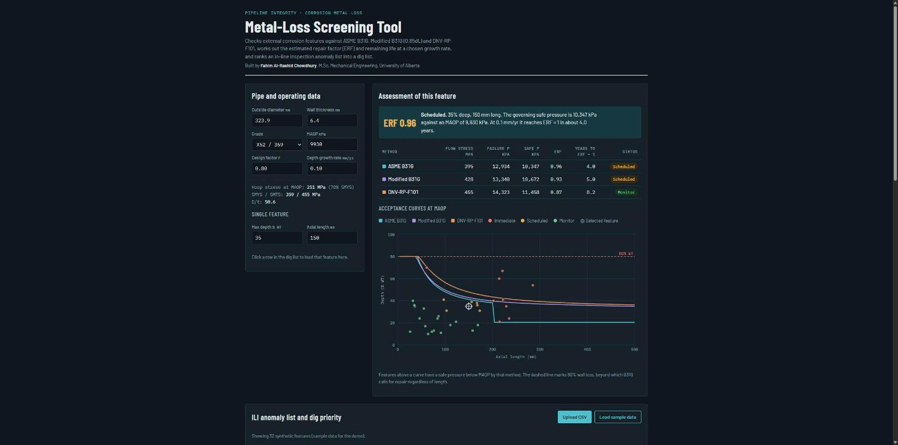

# Pipeline Metal-Loss Screening Tool

An interactive screening tool for external corrosion features on pipelines. It assesses each feature with **ASME B31G**, **Modified B31G (0.85dL)** and **DNV-RP-F101**, calculates the estimated repair factor (ERF) and remaining life at an assumed corrosion growth rate, and ranks an in-line inspection (ILI) anomaly list into a dig list.

**Live demo:** https://fahimalr.github.io/pipeline-metal-loss-screening/



## What it does

- **Single-feature check.** Enter pipe diameter, wall thickness, grade, MAOP, design factor and growth rate, then a feature's depth and length. The tool returns flow stress, failure pressure, safe pressure, ERF and years to ERF = 1 for each method.
- **Acceptance curves.** Plots depth against length curves at MAOP for all three methods, with every anomaly shown against them.
- **ILI dig list.** Upload a CSV of anomalies and the tool ranks them as *Immediate*, *Scheduled* or *Monitor* using the most conservative of the three methods.
- **Python module.** `metal_loss.py` implements the same calculations for batch use, scripting or checking results.

## Methods

| Method | Flow stress | Folias factor | Failure stress |
|---|---|---|---|
| ASME B31G | 1.1·SMYS | M = √(1 + 0.8z), z = L²/(D·t) | z ≤ 20: S = Sflow·(1 − ⅔·d/t)/(1 − ⅔·d/t/M); z > 20: S = Sflow·(1 − d/t) |
| Modified B31G | SMYS + 69 MPa | z ≤ 50: M = √(1 + 0.6275z − 0.003375z²); z > 50: M = 0.032z + 3.3 | S = Sflow·(1 − 0.85·d/t)/(1 − 0.85·d/t/M) |
| DNV-RP-F101 (Part B) | SMTS | Q = √(1 + 0.31·(L/√(D·t))²) | P = 2·t·SMTS·(1 − d/t)/((D − t)·(1 − (d/t)/Q)) |

For B31G and Modified B31G, failure pressure is P = 2·S·t/D.

- **Safe pressure** = failure pressure × design factor F. **ERF** = MAOP / safe pressure.
- **Remaining life** assumes depth grows linearly at the set rate with length held constant. It ends when ERF reaches 1 or depth reaches 80% of wall thickness.
- **Priority:** *Immediate* if the worst ERF ≥ 1 or depth ≥ 80% WT. *Scheduled* if ERF ≥ 0.9 or remaining life is under 5 years. Otherwise *Monitor*.

## Running it

**Web tool:** open `index.html` in any browser. No installation or server is needed.

**Python:**

```bash
python metal_loss.py data/sample_ili_anomalies.csv
```

```python
from metal_loss import Pipe, GRADES, METHODS, erf
smys, smts = GRADES["X52"]
pipe = Pipe(D=323.9, t=6.4, smys=smys, smts=smts, maop=9.93)
d, L = 0.35 * pipe.t, 150          # 35% WT deep, 150 mm long
for name, f in METHODS.items():
    print(name, round(f(pipe, d, L), 2), "MPa,", "ERF", round(erf(pipe, f, d, L), 2))
```

## CSV format

```
id,distance_m,depth_pct,length_mm
ML-001,1559.9,33,55
```

An optional `wt_mm` column overrides the nominal wall thickness for a feature. The file in `data/` is **synthetic data** generated for the demo.

## Limitations

This is a portfolio and learning project, not a substitute for an engineering assessment under CSA Z662 and an operator's integrity management program. It covers blunt metal loss under internal pressure only. It does not cover cracks, dents, interacting defects, features in welds, or external loads.

## Author

**Fahim Al-Rashid Chowdhury**, M.Sc. Mechanical Engineering, University of Alberta. Research in fatigue crack growth and fitness-for-service of spiral-welded X70 pipeline steel (IPC 2026, paper IPC2026-186351).

## Licence

MIT
